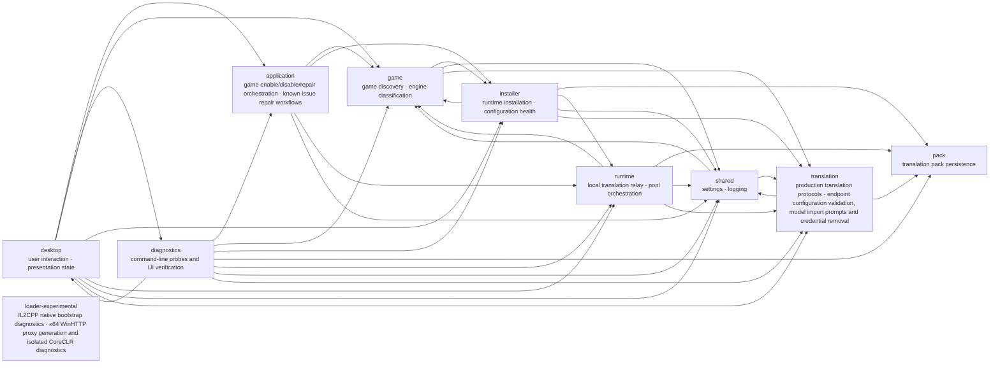

# Franca 蓝图（模块契约图）

> 自动生成：`Franca.exe --probe-blueprint`。数据源是 `architecture.json` 的 modules（paths / dependsOn / contract），边由真实源码引用扫描得出。请勿手改本文件；改模块边界时更新 architecture.json 并重跑探针。关键数据流时序见 [BLUEPRINT-FLOWS.md](BLUEPRINT-FLOWS.md)。

实线 = 代码中真实存在的引用；红色实线 = 存在但未在 dependsOn 声明（探针 FAIL）；灰色虚线 = 已声明但代码中暂无引用（WARN）。

## 对账结果

- 未声明边：无
- 漂移边：无
- 未归类文件：无

## 模块契约

### `desktop`

- 职责：user interaction；presentation state
- 文件：21 个；声明依赖：`application`、`game`、`installer`、`runtime`、`translation`、`shared`、`diagnostics`
- 输入：
  - `user actions on pages (library toggle, settings, endpoint management)`
  - `WPF timers and service events (relay counters, auto-pick results)`
- 输出：
  - `calls into application/query services`
  - `rendered status, overlay window, persisted UI preferences`
- 不变量：
  - `views never parse INI, call HTTP, or write translation packs directly`
  - `window owns service instances, timers and subscriptions; all released on close`
- 验证探针：
  - `--probe-navigation`
  - `--probe-startup`
  - `--probe-dialog`
  - `--probe-library`

### `application`

- 职责：game enable/disable/repair orchestration；known issue repair workflows
- 文件：2 个；声明依赖：`game`、`installer`、`runtime`、`shared`
- 输入：
  - `enable/disable/repair requests from pages`
  - `game identity and target directory`
  - `debounced source/target-language configuration requests with a settings snapshot`
- 输出：
  - `orchestrated install/health-check/repair steps`
  - `runtime preparation before game launch`
  - `launch games via steam://rungameid/<appid>`
  - `diagnosable per-step results`
- 不变量：
  - `installer never holds or starts the relay`
  - `enable/disable is reversible; writes to game directories keep recoverable backups`
  - `automatic language apply only touches stopped installed Unity games; preserves disabled state, skips running/unknown processes, and serializes with toggles/repairs`
- 验证探针：
  - `--probe-toggle`
  - `--probe-health`
  - `--probe-architecture`
  - `--probe-language-apply`

### `game`

- 职责：game discovery；engine classification；library metadata and name resolution
- 文件：8 个；声明依赖：`translation`、`installer`、`shared`
- 输入：
  - `Steam library folders, appmanifest files and local appcache/appinfo.vdf v39-v41 metadata`
  - `game directory file signatures`
- 输出：
  - `installed game list with engine tags`
  - `translated/segmented game names`
  - `library ordering and icons`
- 不变量：
  - `appmanifest supplies installed app ids; unmanifested directories with exe remain fallback rows without app ids; appinfo only classifies and never proves installation`
  - `known Steam game/demo/mod types override software name fallbacks; known software types and auxiliary-only EA anti-cheat directories are reversibly hidden; unknown types remain visible unless a known software signature matches`
  - `engine detection is local file signatures only, no network or model`
- 验证探针：
  - `--probe-library`
  - `--probe-names <lang> <primaryEndpointId>`

### `installer`

- 职责：runtime installation；configuration health；repair；journalled installation and interrupted-install recovery；static archive patching for Touhou (ZUN engine) data packages；thcrap runtime translation patching for Touhou (ZUN engine) games；procedural localized menu sprite generation for Touhou th10/th11 (title.anm PNGs)；experimental UE v11 pak, locres and restricted cooked FText DataTable preparation outside game directories
- 文件：18 个；声明依赖：`game`、`translation`、`runtime`、`pack`、`shared`
- 输入：
  - `explicit relay address`
  - `target game directory`
  - `explicit UE source pak, selected locres or supported DataTable paths, settings snapshot and outside-game output/cache roots`
- 输出：
  - `BepInEx/XUnity files and AutoTranslatorConfig.ini`
  - `health reports and backups`
  - `ReloadTranslationsOnFileChange=True in template`
  - `UE prepared pak plus completion manifest outside game directories; not installed`
- 不变量：
  - `never starts the relay; relay address is always passed in explicitly`
  - `backs up before every write; health check covers config, runtime files and reload flag`
  - `runtime packages are staged before mutation; pending transactions cannot be ready`
  - `rollback retains backups and refuses to overwrite external edits`
  - `Touhou static route stages unpack/translate/repack in a temp workspace; the game directory only sees verified archives plus .frorig/.frpatched reversible renames`
  - `Touhou thcrap route never modifies game data files; thtk unpack/dump is read-only and translations ship as jdiff patches under the thcrap working tree`
  - `thcrap working tree is copied from the bundled ThirdParty/thcrap on first use and works fully offline (no update servers)`
  - `exe swap is reversible (thNN.exe.frorig backup plus marker-checked stub) and refuses unrecognized game builds via base_tsa versions.js`
  - `jdiff box keys follow thcrap time_ind semantics: all boxes of a time are written together with line counts matching the original`
  - `UE preparation reads original archives only; rejects output/cache paths inside games and reparse-point output ancestors; completion manifest marks an immutable generation`
  - `UE translation uses instance-scoped packs and breakers, settings snapshot, 2500 input and 200 request limits; caches successful fragments and complete documents only; free-only by default`
  - `UE overlays are uncompressed after the target UE4.26 rejected compressed payloads; translation language and installed culture slot are explicit separate values`
- 验证探针：
  - `--probe-health`
  - `--probe-toggle`
  - `--probe-installation`
  - `--probe-touhou-thcrap`
  - `--probe-ue-pak`
  - `--probe-ue-static`

### `runtime`

- 职责：local translation relay；pool orchestration；failure-open behavior；paragraph and sentence segmentation；bounded fragment queue and document reconstruction；game text sync (Franca.txt full dump and buffered appends)；translation status overlay model (status lines from relay counters, lab/011)
- 文件：7 个；声明依赖：`game`、`translation`、`pack`、`shared`
- 输入：
  - `GET /translate/<appid>?text=...&from=...&to=...`
  - `UpgradeCompleted events from relay background upgrades`
  - `running game process signals`
- 输出：
  - `translated text or 503 (retry signal)`
  - `writes <game>/BepInEx/Translation/<lang>/Text/Franca.txt`
  - `creates a missing default _AutoGeneratedTranslations.txt before publishing Franca.txt; never replaces existing cache text`
  - `overlay status lines (mode, hit rates, in-flight/failures)`
  - `relay counters (DictHits/InFlight/Failures)`
- 不变量：
  - `dictionary entries are never written to Franca.txt`
  - `incomplete segmented requests return 503; never a partial document`
  - `per-instance isolation; single request captures one settings snapshot`
  - `relay failures have error/retry paths; impact on game behavior requires integration testing`
- 验证探针：
  - `--probe-relay`
  - `--probe-segmentation`
  - `--probe-dictionary`
  - `--probe-architecture`

### `translation`

- 职责：production translation protocols；endpoint configuration validation, model import prompts and credential removal；provider health checks；automatic endpoint selection；built-in dictionary lookup and seed entries
- 文件：13 个；声明依赖：`pack`、`shared`
- 输入：
  - `text + language pair + settings snapshot`
  - `endpoint definitions and keys`
- 输出：
  - `translated text per production protocol`
  - `endpoint health outcomes and automatic selection`
  - `dictionary hits (trim + case-insensitive)`
- 不变量：
  - `speed tests reuse production protocols; EndpointTestService only wraps health checks`
  - `auto-switch hysteresis: new candidate at least 30% faster and switches at least 45s apart`
  - `dictionary auto-sedimentation only for source text up to 30 chars, never overwrites existing keys`
- 验证探针：
  - `--probe-architecture`
  - `--probe-dictionary`
  - `--probe-free [lang]`
  - `--probe-translate <endpointId> <lang> <text>`

### `pack`

- 职责：translation pack persistence
- 文件：2 个；声明依赖：无
- 输入：
  - `appId + language + source/translated pairs`
- 输出：
  - `JSONL pack files under packs/<appid>/<lang>/entries/<hh>.jsonl`
  - `cache hits for repeated source text`
- 不变量：
  - `same text in different games stays isolated by appId`
  - `existing keys are never overwritten by sedimentation`
- 验证探针：
  - `--probe-relay`
  - `--probe-architecture`

### `shared`

- 职责：settings；logging；local text and attribution resources；engine support catalog；DNS warmup
- 文件：6 个；声明依赖：`translation`、`game`
- 输入：
  - `settings read/write from any module`
  - `log calls`
- 输出：
  - `deep-copied settings snapshots`
  - `log file lines`
  - `localized UI strings and attribution data`
  - `engine support list derived from engine installability`
- 不变量：
  - `snapshots are deep copies; mutating a snapshot never affects live settings`
  - `logs never contain API keys or full game text`
- 验证探针：
  - `--probe-architecture`
  - `--probe-startup`

### `diagnostics`

- 职责：command-line probes and UI verification
- 文件：25 个；声明依赖：`application`、`desktop`、`game`、`installer`、`runtime`、`translation`、`pack`、`shared`
- 输入：
  - `--probe-* command-line arguments`
- 输出：
  - `RESULT<TAB>category<TAB>name<TAB>PASS|FAIL lines`
  - `process exit code; app shuts down without opening a window`
- 不变量：
  - `synthetic fixtures, temporary directories and loopback HTTP only, unless a probe documents live-network side effects`
  - `probes never modify real games; probe success is not real-game acceptance`

### `loader-experimental`

- 职责：IL2CPP native bootstrap diagnostics；x64 WinHTTP proxy generation and isolated CoreCLR diagnostics
- 文件：1 个；声明依赖：无
- 输入：
  - `IL2CPP game process`
- 输出：
  - `bootstrap diagnostics log`
- 不变量：
  - `build artifacts are never committed; experimental, not part of the desktop build`
- 验证探针：
  - `pwsh -File src/Loader/test.ps1`
